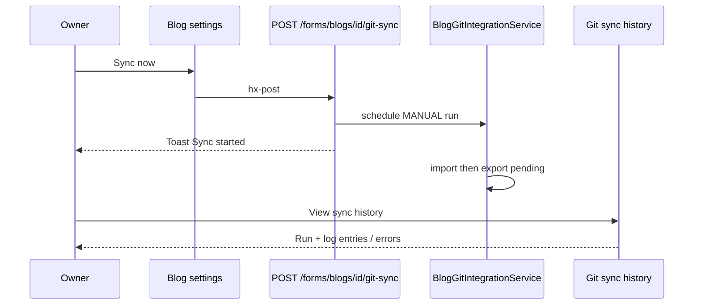

# Git ↔ Jekyll sync

**Feature version:** 4  
**Status:** review-ready  
**Production:** live (v1); v2 not shipped; v3 not shipped; v4 not shipped

## Changelog

### Shared Git repository across multiple blogs — 2026-08-05

**Version:** 4  
**Status:** review-ready

**Description:** Today `_contraponto.yml` is always read from the **repository root** (`JekyllLayoutConvention.CONFIG_FILENAME`, a hardcoded constant) — so two blogs pointed at the same `gitRemoteUrl` would both read the same config and scan the same `_posts`/`_drafts` folders, importing identical files into two different blogs. Add a per-blog, optional **Git config path**: the full repo-relative path to that blog's `_contraponto.yml` file (e.g. `blog-b/_contraponto.yml`), not just a directory. When unset, behavior is unchanged (`_contraponto.yml` at repo root, or hardcoded defaults if that file is absent). When set, Contraponto reads the config from that path instead. Because the existing `posts_directory` / `drafts_directory` / `assets_directory` overrides inside `_contraponto.yml` are already interpreted **relative to repo root** (not relative to the config file itself), pointing two blogs' config paths at two different files already lets each declare its own non-overlapping subtree (`blog-a/_posts`, `blog-b/_posts`, …) in the **same repository, same remote URL, same or different branch** — no change needed to how those directory values are resolved. To prevent the obvious duplicate-import mistake, saving a blog whose `gitRemoteUrl` **and** config path (including blank-vs-blank) already match another blog **owned by the same author** is **rejected with an error**, validated client-side where feasible and always enforced server-side.

**Domain model:** updated 2026-08-05 — see [domain-specification.md](../docs/domain-specification.md) § Git sync (**Git config path**; invariant 51: `gitRemoteUrl` + config path unique per author).

**Impact on other features:**

| Feature / area | Impact |
|----------------|--------|
| [git-jekyll-convention.md](../docs/git-jekyll-convention.md) | Document the config-path parameter and the "shared repository, distinct subtrees" pattern |
| [multi-blog.md](multi-blog.md) | Primary use case: one author's main blog + a secondary blog backed by the same personal-site repo, each in its own subdirectory |
| `dev-import.sql` | Seed two blogs on the same `gitRemoteUrl` with distinct `gitConfigPath` values, demonstrating the shared-repo pattern |
| Existing conflict recovery | Relies on, does not change, the existing two-clones-same-remote conflict handling (`BlogGitIntegrationService.recoverFromConflictingPull`, production fix 2026-08-04) — two blogs already get separate `blog-{id}` clone workspaces today, so no workspace collision |

#### Feature checklist

| ID | Criterion | Source | Done |
|----|-----------|--------|------|
| FC19 | Blog settings Git section: optional **Git config path** field (full repo-relative path to the `_contraponto.yml` file) | FQ19 | ☑ |
| FC20 | Blank config path → unchanged current behavior (root `_contraponto.yml` or defaults) | FQ19 | ☑ |
| FC21 | Set config path → Contraponto reads that file for `posts_directory`/`drafts_directory`/`assets_directory`/etc., unchanged root-relative semantics for the values inside it | FQ19 | ☑ |
| FC22 | Saving a blog whose `gitRemoteUrl` + config path (blank-vs-blank counts as a match) duplicates another blog **owned by the same author** is **rejected with an error message**, not saved | FQ20, FQ22 | ☑ |
| FC22a | Duplicate check is validated **client-side** (form validation) in addition to the server-side check | FQ20 | N/A — superseded by AQ11 (reuse existing submit-time toast; no live-check component built) |
| FC23 | Configured path that doesn't exist in the repo produces a clear sync-run error rather than silently falling back | FQ21 | ☐ — not implemented; a missing custom config path currently falls back to defaults silently, same as today's root-path behavior. Gap, not a regression |
| FCdev | `dev-import.sql` + feature-catalog: two blogs, one repo, two config paths | FCdev | ☑ |

#### Wireframe (v4 delta)

##### Screen: Blog settings — Git section (`GET /blogs/{id}/settings` or edit)

| Region | Elements | Notes |
|--------|----------|-------|
| Git config path | Text input, e.g. `blog-b/_contraponto.yml` | Optional; blank = default (`_contraponto.yml` at repo root) |

```text
Git config path (optional):
[ blog-b/_contraponto.yml                            ]
  Leave blank to use _contraponto.yml at the repository root.
  Set this when two blogs share the same repository, so each
  reads its own config and stays within its own subdirectory.

⚠ Another of your blogs already uses this repository with this
  same config path. Choose a different config path, or leave
  one of the two blank to use the repository root.
  (shown inline; save is blocked until resolved)
```

### Legacy link rewrite on Git import — 2026-08-05

**Version:** 3  
**Status:** review-ready

**Description:** Authors who migrate a blog into Contraponto from an existing site (e.g. a Jekyll blog at `blog.vepo.dev`) often have old posts whose **body links point at that old domain**, including **self-links to their own other posts** (`https://blog.vepo.dev/posts/post-1-slug`). Add a per-blog **legacy link pattern**: a host+path **template** with a literal `{slug}` placeholder (e.g. `blog.vepo.dev/posts/{slug}`) configured in the Git section of blog settings — no regex authoring. On **Git import**, any link in the post body matching the pattern has its slug extracted and looked up against posts owned by the **same author across all of that author's blogs** (not just the blog being synced — post slug is already unique per author, invariant 3). If found, the link is rewritten to that post's current **canonical internal URL** (e.g. `https://vepo.commit-mestre.dev/post/post-1-slug`); if no post with that slug exists yet, the link is left unchanged rather than risk a broken internal link. Because the pattern is author-supplied and may be wrong or need broadening later, **changing the pattern reprocesses every already-imported post on that blog** — rewriting both the working-copy body **and already-published publication snapshots**, so readers see corrected links immediately without the author needing to republish.

**Domain model:** updated 2026-08-05 — see [domain-specification.md](../docs/domain-specification.md) § Git sync (**Legacy link pattern**, **Legacy link rewrite**, **Legacy link reprocess**; invariant 50, the narrow exception to publication-snapshot immutability). Stays in the **Git sync** vocabulary (`git` bounded context) — it is triggered by and configured on Git integration, even though it writes into `post`'s `PostPublication` rows, mirroring the existing **Git publish date alignment** precedent (`git` calling into `PostPublicationService` directly, not via a CDI event).

**Impact on other features:**

| Feature / area | Impact |
|----------------|--------|
| [git-jekyll-convention.md](../docs/git-jekyll-convention.md) | New documented convention: `legacy_link_pattern` (or blog-settings field), rewrite semantics, reprocess-on-change |
| [post-publishing.md](post-publishing.md) | Reprocessing rewrites **published snapshots** in addition to the working copy (FQ15) — touches rows normally treated as immutable-once-published; needs explicit architecture sign-off on how that's done safely |
| [seo.md](seo.md) | Internal links keep readers on-domain instead of bouncing to a legacy/dead host; canonical URL construction must reuse `BlogPublicUrlService`/`PostPaths`, never a hardcoded domain |
| [multi-blog.md](multi-blog.md) | Pattern is configured **per blog** (main or secondary), consistent with existing Git settings scope |
| Docs | [git-jekyll-convention.md](../docs/git-jekyll-convention.md), [feature-catalog.md](../docs/feature-catalog.md) |
| `dev-import.sql` | Seed a blog with a configured pattern + a sample post whose body contains a legacy self-link, to demonstrate the rewrite in dev |

#### Feature checklist

| ID | Criterion | Source | Done |
|----|-----------|--------|------|
| FC13 | Blog settings Git section: **legacy link pattern** field — host + path template with a literal `{slug}` placeholder, one per blog | FQ11, FQ14 | ☑ |
| FC14 | Git import rewrites body links matching the pattern to the canonical internal URL of the post with that slug **on any blog owned by the same author** (via `BlogPublicUrlService`/`PostPaths`, not a hardcoded domain) | FQ12, FQ16, FQ18 | ☑ |
| FC15 | Saving a changed (or newly set) pattern reprocesses **all** already-imported posts on that blog, not just future imports | FQ15 | ☑ |
| FC16 | Reprocessing rewrites both the working-copy body **and** already-published publication snapshots, so readers see corrected links without a republish | FQ15 | ☑ |
| FC17 | A link whose slug does not resolve to an existing post of the author (on any of their blogs) is left **unmodified** (no broken internal link) | FQ13, FQ18 | ☑ |
| FC18 | Reprocessing outcome is visible to the author (e.g. toast with a rewritten-link count) | FQ17 | ◐ toast fires on save ("Reprocessing legacy links…") but carries no count — the count isn't known synchronously; full outcome is visible via Git sync history (`REPROCESS` run) once it completes |
| FCdev | `dev-import.sql` + feature-catalog: blog with pattern configured, sample post with a legacy self-link | FCdev | ◐ pattern seeded on `notas`; no static seeded post demonstrates the rewrite (git-enabled blogs get posts from live sync, not static seed, matching existing convention) |

#### Wireframe (v3 delta)

##### Screen: Blog settings — Git section (`GET /blogs/{id}/settings` or edit)

| Region | Elements | Notes |
|--------|----------|-------|
| Legacy link pattern | Text input, e.g. `blog.vepo.dev/posts/{slug}` | Optional; blank = no rewrite. Hint shows an example before/after |
| Reprocess feedback | Toast / inline note after save when pattern changed | "Reprocessing N posts…" (FQ17) |

```text
Legacy link pattern (optional):
[ blog.vepo.dev/posts/{slug}                        ]
  Example: a link to https://blog.vepo.dev/posts/hello-world
  in an imported post's body becomes an internal link to
  https://vepo.commit-mestre.dev/post/hello-world

⚠ Changing this reprocesses every already-imported post on this blog.
```

### Production fix — conflicting remote history crashed sync — 2026-08-04

**Version:** 1  
**Status:** done

**Production:** live — deployed fix

**Description:** `BlogGitIntegrationService.fetchAndPull` discarded the `PullResult` returned by JGit's `pull()`. When two machines (or a machine and a manual push) diverge on the same blog repository, the merge conflicts, but nothing detected this — the code proceeded to write/add/commit as if the pull had succeeded, and `git.commit()` then threw (`WrongRepositoryStateException`/`UnmergedPathsException` while the repo was mid-conflict), surfacing as an unhandled 500 from the "Ver histórico de sincronização" / Sync now paths. Fixed: after a pull, check `PullResult.isSuccessful()`; on a conflicting/failed merge, hard-reset the local workspace to the just-fetched remote branch tip (`refs/remotes/origin/{branch}`) and let the existing export logic re-derive the post's file from the database on top of that reset. Safe because the local Git workspace is a **generated export of the database**, never an independently authored source of truth — nothing DB-authored is lost by discarding a conflicted local merge.

**Domain model:** N/A — no vocabulary change; existing invariant "Git sync run" outcome semantics unchanged (now reaches `SUCCESS` in a case that previously threw).

**Impact on other features:** None — same export/import call sites, same public behavior on the non-conflicting path; conflicting-pull path now succeeds instead of 500ing.

**Implementation notes:** `BlogGitIntegrationService.fetchAndPull` / `recoverFromConflictingPull`. Regression test: `BlogGitIntegrationServiceTest#exportRecoversFromConflictingRemoteHistoryInsteadOfFailing` (two-machine divergence on the same file, asserts export succeeds and reconciled DB content is written).

**Review approval:** N/A — user-directed emergency production fix, verified via automated regression test and full `-Ptest-quarkus` suite green.

### Per-blog credentials, auto-sync toggle, manual Sync — 2026-07-10

**Version:** 2  
**Status:** architecture-ready

**Description:** Authors configure **Git credentials on the blog only**: **HTTPS** username + password/PAT, or **SSH** private key (+ optional passphrase). Remotes may be HTTPS or SSH. **No server-wide credential fallback** — if the owner’s credentials are missing or wrong, the sync run **fails with a clear error** in history. A per-blog **Automatic sync** toggle: when off, the blog does **nothing** until **Sync now**. **Sync now** runs **import** plus **export of pending** local changes if any. Secrets are stored **encrypted at rest**, never re-displayed; UI warns authors to use a **dedicated** deploy key / PAT.

**Domain model:** updated 2026-07-10 — see [domain-specification.md](../docs/domain-specification.md) § Git sync (credentials, transport, automatic sync, Sync now; invariants 18–19)

**Impact on other features:**

| Feature / area | Impact |
|----------------|--------|
| [multi-blog.md](multi-blog.md) | Git section on blog **Settings** / **Edit**; credentials **per blog** (FQ3) |
| [post-publishing.md](post-publishing.md) | Export on publish/draft **only** when automatic sync is on (FQ4); otherwise no Git side effect |
| [account-deletion.md](account-deletion.md) | Blog delete must wipe encrypted credential columns with the blog |
| [authentication.md](authentication.md) | No change to login; blog owner gate unchanged |
| Ops / deployment | **Remove** reliance on `contraponto.git.username`/`password` for sync auth (FQ5); add encryption secret for at-rest storage; document deprecation of server Git credentials |
| Docs | [git-jekyll-convention.md](../docs/git-jekyll-convention.md), [deployment.md](../docs/deployment.md), [feature-catalog.md](../docs/feature-catalog.md) |
| `dev-import.sql` | Seed auto-sync off/on for `vepo` `notas`; **no** real secrets (credential-present false) |
| Error UX | Auth/transport failures must surface in sync history + notification (FQ5, FC11) |

#### Feature checklist

| ID | Criterion | Source | Done |
|----|-----------|--------|------|
| FC5 | Blog settings: HTTPS username + password/PAT (replace / clear); warning to use a dedicated PAT | FQ3, FQ5, FQ6 | ☐ |
| FC6 | Blog settings: SSH private key textarea + optional passphrase; warning to use a dedicated deploy key | FQ3, FQ6 | ☐ |
| FC7 | Remote URL accepts HTTPS **or** SSH; transport drives credential fields | FQ3 | ☐ |
| FC8 | **Automatic sync** off → blog does nothing (no poll, no export on publish/draft/warmup) until Sync now | FQ4 | ☐ |
| FC9 | **Sync now** (settings + history): import + export pending if any; trigger `MANUAL` | FQ1, FQ7 | ☐ |
| FC10 | Secrets stored encrypted at rest; never shown in UI, logs, or sync history snapshots | FQ6, FQ10 | ☐ |
| FC11 | Missing/invalid credentials and opaque transport failures → clear error in run history (and existing failure notification) | FQ5 | ☐ |
| FC12 | UI copy: secrets “kept encrypted / not shown again”; create a **specific** key or PAT for Contraponto | FQ6 | ☐ |
| FCdev | `dev-import.sql` + feature-catalog § Dev personas / Git rows | FCdev | ☐ |

#### Wireframe (v2 delta)

##### Screen: Blog settings — Git section (`GET /blogs/{id}/settings` or edit)

| Region | Elements | Notes |
|--------|----------|-------|
| Enable | Checkbox **Enable Git sync for this blog** | Existing |
| Remote | URL + branch | Hint: HTTPS or SSH (`git@…` / `ssh://…`) |
| Transport hint | Read-only label HTTPS / SSH | Derived from URL |
| HTTPS credentials | Username; password/PAT (blank = keep); **Clear stored credentials** | Shown when HTTPS |
| HTTPS warning | Hint under password | Create a **dedicated PAT** for this blog; stored encrypted and never shown again |
| SSH credentials | Private key textarea; optional passphrase; **Clear stored key** | Shown when SSH (FQ6) |
| SSH warning | Hint under key | Create a **dedicated deploy key** for this blog; stored encrypted and never shown again |
| Auto sync | Checkbox **Automatic sync** | When **off**: do nothing for this blog until Sync now (FQ4) |
| Actions | **Sync now** button; link **View sync history** | Owner-only; toast on start; failures → history (FQ5) |

##### Screen: Git sync history (`GET /blogs/{blogId}/git-sync`)

| Region | Elements | Notes |
|--------|----------|-------|
| Header | **Sync now** + existing title | Same form POST as settings |
| List | Existing run rows | Show `MANUAL` trigger; auth errors readable (FQ5) |

```text
[✓] Enable Git sync for this blog

Remote URL: [ https://…  or  git@host:path.git ]
Branch:     [ source ]
Transport:  HTTPS | SSH   (derived)

── HTTPS ──
Username: [ …… ]
Password / PAT: [ …… ]  (leave blank to keep)
[ ] Clear stored credentials
⚠ Create a dedicated personal access token for this blog.
  It is stored encrypted and will never be shown again.

── SSH (when URL is SSH) ──
Private key: [ paste PEM / OpenSSH ]
Passphrase (optional): [ …… ]
[ ] Clear stored key
⚠ Create a dedicated deploy key for this blog.
  It is stored encrypted and will never be shown again.

[✓] Automatic sync
    When off: this blog does nothing until you press Sync now.

[ Sync now ]     [ View sync history ]
```

### Production baseline — 2026-07-07

**Version:** 1  
**Status:** done

**Production:** live — deployed capability

**Development approval:** approved — production baseline (shipped)  
**Review approval:** approved 2026-07-07 — production baseline

#### Feature checklist (v1)

| ID | Criterion | Done |
|----|-----------|------|
| FC1 | Enable Git on blog settings | ☑ |
| FC2 | Export on publish/draft | ☑ |
| FC3 | Sync history + run detail UI | ☑ |
| FC4 | Failed sync notifications | ☑ |
| FCdev | `alice`, `vepo` blogs with git_enabled | ☑ |

## Summary

Per-blog **Git integration** exports posts to a remote **Jekyll-compatible** repository and **imports** remote changes. **v1** uses server-wide HTTPS credentials (`contraponto.git.username` / `password`), HTTPS remotes only, automatic export on publish/draft, optional scheduled poll, and **sync history**.

**v2** (planned) moves credentials to the **blog settings UI only** (HTTPS password/PAT or SSH key — no server fallback), allows SSH remotes, adds **Automatic sync** (when off: idle until Sync now), and **Sync now** (import + export pending). Secrets are encrypted at rest and never re-displayed; authors are warned to use a dedicated key/PAT.

## Wireframe

| Screen | Route | Notes |
|--------|-------|-------|
| Blog settings — Git section | `GET /blogs/{id}/settings` (also edit) | Enable, remote, branch; **v2:** credentials, warnings, auto sync, Sync now |
| Sync history | `GET /blogs/{blogId}/git-sync` | Paginated runs; **v2:** Sync now in header |
| Run detail | `GET /blogs/{blogId}/git-sync/{runId}` | Log entries; auth failures visible |
| Manual sync (form) | `POST /forms/blogs/{id}/git-sync` | **v2** — owner-only; import + export pending |

## Impact

| Area | Effect |
|------|--------|
| Bounded contexts | `git` (integration); blog settings form in `blog` |
| Schema (v1) | `tb_blogs` git columns; `tb_git_sync_runs`, `tb_git_sync_run_entries` |
| Schema (v2) | Per-blog credential columns (encrypted); `git_auto_sync`; credential-present flag |
| CDI | `PostGitSyncRequestedEvent` → `GitPostCommittedObserver` (no-op when auto sync off) |
| Auth for Git | **Only** blog-owner credentials (FQ5); missing/wrong → failed run + error detail |
| Docs | [git-jekyll-convention.md](../docs/git-jekyll-convention.md), deployment (deprecate server Git user/pass for auth), feature-catalog |
| Tests | Credential/SSH/manual/auto-sync; assert no use of server username/password; failure messaging |

### Risks

| Risk | Mitigation |
|------|------------|
| Secrets in DB / backups | Encrypt at rest (AES-GCM); never log or snapshot plaintext (FQ10) |
| SSRF via SSH/HTTPS remotes | Extend outbound host validation for both transports |
| SSH host key MITM | Pin / known_hosts under workspace (**AQ2**) |
| Auto sync off → silent idle | Copy: “does nothing until Sync now” (FQ4) |
| No server fallback | Authors must set credentials; clear auth errors in history (FQ5, FC11) |
| Opaque JGit errors | Classifier + user-facing remediation (FC11) |
| Import success silent | Unchanged — failures/partials + export success only (FQ2) |

### Feature questions (FQ*n*)

| # | Question | Status | Answer |
|---|----------|--------|--------|
| FQ1 | Manual **Sync now** button? | answered | **Yes** — settings + history; trigger `MANUAL` |
| FQ2 | Notify on import success? | answered | **No** — failures/partials + export success only |
| FQ3 | Credential scope: per blog, per user, or hybrid? | answered | **Per blog** |
| FQ4 | What does **Automatic sync** disable? | answered | When off: **do nothing** for the blog — wait for manual Sync now (no poll, no export on publish/draft/warmup) |
| FQ5 | Keep server-wide `contraponto.git.username`/`password` as fallback? | answered | **No.** Use only credentials the blog owner sets. If sync fails, record/show the error (history + existing failure notification) |
| FQ6 | How does the author provide the SSH private key? | answered | **Textarea.** Store **encrypted** (FQ10). Warning: create a **dedicated** key; it is kept encrypted and never shown again. Same warning pattern for HTTPS PAT |
| FQ7 | What does **Sync now** run? | answered | **Import + export pending** if any |
| FQ8 | Concurrent Sync now while a run is already active for the blog? | open | **Proposed:** skip with toast — one active run per blog |
| FQ9 | Confirm modal before Sync now? | open | **Proposed:** no — toast + history link |
| FQ10 | Storage of secrets: hash or encrypt? | answered | **Encrypted** (reversible crypto at rest) — not one-way hash. Product copy: “stored encrypted / never shown again” |
| FQ11 | Pattern syntax: regex with a capture group, or a template with a literal `{slug}` placeholder? | answered | **Template placeholder** — `{slug}` token in a host+path string, e.g. `blog.vepo.dev/posts/{slug}`. No regex authoring |
| FQ12 | Scope of the rewrite: only links inside the post **body** (Markdown/AsciiDoc prose), or also any front-matter URL fields? | open | **Proposed:** body only — no front-matter field currently holds an arbitrary post URL |
| FQ13 | A matched link's slug does not correspond to any existing post (checked across the author's blogs — FQ18) — leave unmodified, or rewrite anyway and risk a 404? | answered | **Leave unmodified** (FC17) — safe default, no broken internal links |
| FQ14 | One pattern per blog, or does an author need several (e.g. blog moved domains more than once)? | answered | **One pattern per blog** |
| FQ15 | Does reprocessing rewrite only the working-copy `Post.content`, or also already-published **publication snapshots** (invariant 6)? | answered | **Both** — working copy and published snapshots, so readers of already-published posts see the internal link immediately without the author republishing |
| FQ16 | Target URL: platform path (`PostPaths`) or subdomain canonical (`BlogPublicUrlService.absoluteCanonical`) when subdomains are enabled? | open | **Proposed:** subdomain canonical, consistent with SEO/RSS/email (domain-spec § Dual URL & canonical links) |
| FQ17 | How does the author learn a reprocess ran and what changed — toast with a count, a Git-sync-history-style entry, or nothing beyond the updated post bodies? | open | **Proposed:** toast with a rewritten-link count, no new history entry type (mirrors v2 Sync now: toast only) |
| FQ18 | Resolution scope: match the extracted slug against posts on **this blog only**, or **any blog owned by the same author**? | answered | **Any blog owned by the same author** — consistent with invariant 3 (post slug unique per author across all their blogs), so a legacy link can resolve to a post that landed on a secondary blog |
| FQ19 | Does the **Git config path** field hold the full relative path to the `_contraponto.yml` file (e.g. `blog-b/_contraponto.yml`), or just the containing directory (filename `_contraponto.yml` always assumed)? | answered | **Full relative file path** to the yml file itself, e.g. `blog-b/_contraponto.yml` |
| FQ20 | Should Contraponto warn or block when two blogs are saved with the **same** `gitRemoteUrl` **and** the same (or both blank) config path — i.e. a likely duplicate-import misconfiguration — or is that left entirely to the author? | answered | **Block, not just warn.** Save is **rejected with an error message**; validated **client-side where feasible**, enforced server-side regardless (client-side check is a UX nicety, not a substitute for the server check) |
| FQ21 | Configured config path doesn't exist in the repo at import time — fail the sync run with a clear error, or silently fall back to root `_contraponto.yml` / defaults? | open | **Proposed:** fail with a clear error (consistent with `GitErrorKind.CONVENTION`) — silent fallback would import into the wrong subtree unnoticed |
| FQ22 | Is the duplicate-remote-URL-plus-config-path check scoped to blogs owned by the **same author**, or global across all users? | open | **Proposed:** same author only — the primary use case is one author's own blogs sharing their own repo; two unrelated users coincidentally using the same public template repo isn't the mistake this guards against |

**Blocking for architecture (v3):** none — FQ11, FQ13, FQ14, FQ15, FQ18 (product scope) answered. FQ12, FQ16, FQ17 open but **informational**. v2 FQ8–FQ9 remain informational. Open **AQ2–AQ5** for Architect (v2, unrelated to v3).

**Blocking for architecture (v4):** none — FQ19–FQ20 (product scope) answered. FQ21–FQ22 open but **informational** (proposed defaults carried forward; Architect may confirm via AQ).

**Impact review (2026-08-05):** FQ11, FQ13, FQ14, FQ15, FQ18 answered — recorded above. FQ18 (cross-blog slug resolution) was not anticipated in the original wireframe/checklist; **FC14** and **FC17** below updated to resolve against "any blog owned by the same author," not just the blog being synced. **FC15/FC16** updated: reprocessing now also touches publication snapshots, not just working-copy content.

**Impact review (2026-07-10):** FQ3–FQ7 recorded. Removed server credential fallback. Auto-sync-off = idle until Sync now. Sync now = import + export pending. Added FC12 (dedicated-key warning). **FQ10:** user confirmed **encrypted** (not hashed) — AES-GCM at rest; hash risk row removed.

## Architecture (v2 — per-blog credentials, auto-sync, SSH)

### ADRs aplicáveis

| ADR | Status | Relevância |
|-----|--------|------------|
| [0002](../docs/adr/0002-backend-java-quarkus-jakarta-ee.md) | Accepted | Quarkus / Jakarta |
| [0003](../docs/adr/0003-frontend-qute-htmx.md) | Accepted | Settings form + Sync now via HTMX |
| [0005](../docs/adr/0005-postgresql-database.md) | Accepted | Flyway columns on `tb_blogs` |
| [0013](../docs/adr/0013-cdi-events-cross-context.md) | Proposed | `PostGitSyncRequestedEvent` (gated by automatic sync) |
| [0015](../docs/adr/0015-federation-outbound-fetch-ssrf.md) | Accepted | Outbound host blocking pattern for remotes |
| [0017](../docs/adr/0017-per-blog-git-credentials-ssh.md) | **Proposed** | Per-blog encrypted credentials + SSH; no server auth fallback |

**Stop:** accept **ADR-0017** (and confirm open AQs below) before task break.

### Bounded contexts

| Context | Role |
|---------|------|
| `git` | Credentials crypto, transport, sync orchestration, Sync now endpoint, classifier |
| `blog` | Persist Git fields on `Blog`; settings form save |
| `shared.security` | Extend outbound host validation for SSH remotes (or git-local SSH host validator reusing same blocklists) |
| `notification` | Existing failure/success notifications unchanged |

### Packages / layers

| Layer | Types |
|-------|-------|
| Endpoint | `BlogSaveEndpoint` (credentials + auto sync fields); new `GitSyncTriggerEndpoint` `@Path("/forms/blogs/{id}/git-sync")` |
| Service | `BlogGitCredentialsService` (encrypt/decrypt/clear); `BlogGitIntegrationService` (use blog credentials only; honour auto sync; manual import+export); `GitSyncErrorClassifier` (auth/network for upload-pack) |
| Repository | `BlogRepository.findActiveBlogIdsForGitPoll` filters `gitAutoSync` |
| Config | `ContrapontoGitConfig` / `ContrapontoGitSettings`: add `credentialEncryptionSecret`; **stop reading username/password for auth** |
| Transport | HTTPS: `UsernamePasswordCredentialsProvider` from blog; SSH: JGit Apache SSH + decrypted key |

### Schema (Flyway)

| Column | Type | Notes |
|--------|------|-------|
| `git_auto_sync` | `BOOLEAN NOT NULL DEFAULT TRUE` | Automatic sync |
| `git_auth_username` | `VARCHAR(255)` nullable | HTTPS username only (plaintext; not a secret) |
| `git_auth_secret_encrypted` | `TEXT` nullable | **Encrypted** HTTPS password/PAT **or** SSH private key (same column; transport selects meaning) |
| `git_auth_passphrase_encrypted` | `TEXT` nullable | **Encrypted** SSH key passphrase (optional) |
| `git_credentials_configured` | `BOOLEAN NOT NULL DEFAULT FALSE` | UI “configured” without decrypting |

**Invariant:** HTTPS password/PAT is never stored in plaintext — only ciphertext in `git_auth_secret_encrypted` (same rule as SSH private key). Clear credentials → null ciphertext + `git_credentials_configured = false`. Blank secret on save → keep existing.

### Routes / templates

| Method | Path | Notes |
|--------|------|-------|
| GET | `/blogs/{id}/settings` (and edit) | Extended `gitSyncSection.html` |
| POST | existing blog save form | Persist Git fields + credentials |
| POST | `/forms/blogs/{id}/git-sync` | Sync now — owner only; Toast |
| GET | `/blogs/{id}/git-sync` | History + Sync now button |

### Cross-context

| Mechanism | Change |
|-----------|--------|
| `PostGitSyncRequestedEvent` | Fire / handle only when `gitEnabled && gitAutoSync` |
| `BLOG_SAVE_WARMUP` | Only when auto sync on |
| `GitRemotePollScheduler` | Only blogs with auto sync on |
| `MANUAL` trigger | New; schedules import then export-pending |

### Design específico da feature (v2)

| Area | Design |
|------|--------|
| Credentials | Per blog only ([ADR-0017](../docs/adr/0017-per-blog-git-credentials-ssh.md)); AES-GCM; never in snapshots/logs |
| Transport | HTTPS or SSH from URL; SSH via `org.eclipse.jgit.ssh.apache` |
| Host keys | `known_hosts` under blog workspace; accept-and-pin first success (AQ2) |
| Auto sync | Off → idle until Sync now |
| Sync now | Import + export pending; one active run per blog → toast skip (FQ8 proposed) |
| Failures | Clear auth/network remediation; no silent server fallback |
| Server config | `contraponto.git.credential-encryption-secret` required to store secrets; deprecate username/password for auth |

### HTMX component model

| Component id | Fragment / route | Activator | Request | Swap scope | Events out | Events in | JS companion | Auth allowlist |
|--------------|------------------|-----------|---------|------------|------------|-----------|--------------|----------------|
| `#git-sync` fieldset | Part of blog settings page | Form submit (existing save) | `POST` blog save | Full page / hub redirect as today | Toast on validation error | — | `none` | No |
| Sync now (settings) | `/forms/blogs/{id}/git-sync` | Button click | `hx-post` | None (toast only) or stay on page | `Toast` | — | `none` | No |
| Sync now (history) | same | Button in list header | `hx-post` | same | `Toast` | — | `none` | No |
| History list/detail | existing | Nav links | `hx-get` | `main` + `hx-select="main"` | — | — | `none` | No |

**Mechanism choice:** Sync now → Toast only (priority 1 inline headers via `Toast`); no OOB list refresh required (async run appears on next history load). Credential fieldsets: **static** form (AQ5) — show HTTPS or SSH blocks based on saved URL / server-side after save; no JS companion.

### HTMX interaction diagram



### `htmx-events.md` delta

- §4 **Git Sync now (v2)** — Toast-only mutation; no new custom events; no auth allowlist row.

### Tests

| Kind | Coverage |
|------|----------|
| Unit | Credentials encrypt/decrypt/clear/keep; auto sync gates; classifier for upload-pack → auth/network |
| Quarkus | Sync now schedules run; poll query excludes auto-off; no server username/password used |
| Web | Settings: warnings, Sync now toast; history shows MANUAL / auth error |
| Arch | git package size; no secrets logged |

### Architecture questions (AQ*n*)

| # | Question | Status | Answer |
|---|----------|--------|--------|
| AQ1 | Async export after publish? | answered | **Yes** — observer `AFTER_SUCCESS` |
| AQ2 | SSH host key verification policy? | open | **Proposed (in ADR-0017):** accept-and-pin under blog workspace `known_hosts` |
| AQ3 | Encryption secret shared with ActivityPub? | open | **Proposed (in ADR-0017):** separate `contraponto.git.credential-encryption-secret` |
| AQ4 | JGit SSH library? | open | **Proposed (in ADR-0017):** `org.eclipse.jgit.ssh.apache` |
| AQ5 | Credential fieldset: static vs HTMX swap? | open | **Proposed:** static form; transport from URL validated on save |

**Blocking for task break (v2):** accept **ADR-0017**; confirm **AQ2–AQ5** (or accept proposed). FQ8–FQ9 remain informational.

## Architecture (v3 — legacy link rewrite on Git import)

### ADRs aplicáveis

| ADR | Status | Relevância |
|-----|--------|------------|
| [0002](../docs/adr/0002-backend-java-quarkus-jakarta-ee.md) | Accepted | Quarkus / Jakarta |
| [0003](../docs/adr/0003-frontend-qute-htmx.md) | Accepted | Settings form (new field); Git sync history reused for reprocess visibility |
| [0005](../docs/adr/0005-postgresql-database.md) | Accepted | Flyway column on `tb_blogs` |
| [0012](../docs/adr/0012-post-publication-versioning.md) | **Proposed (amended 2026-08-05)** | Narrow exception: legacy link reprocess may mutate `PostPublication.content` in place |
| [0013](../docs/adr/0013-cdi-events-cross-context.md) | Proposed | New `BlogGitLegacyLinkPatternChangedEvent`, `blog` → `git` (same direction as `PostGitSyncRequestedEvent`) |

**Stop:** confirm the **ADR-0012 exception** (and ADR-0017 v2, unrelated) before task break.

### Bounded contexts

| Context | Role |
|---------|------|
| `blog` | Persist `gitLegacyLinkPattern` on `Blog`; settings form save; fire `BlogGitLegacyLinkPatternChangedEvent` when the value changes |
| `git` | Import-time rewrite (`BlogGitImportService`); reprocess orchestration as a new **Git sync operation**; observes the pattern-changed event |
| `post` | `PostPublicationService` performs the actual content mutation (working copy `Post.content` + every `PostPublication.content`) — `git` calls it directly, mirroring `alignPublicationTimestampFromGit` |

### Packages / layers

| Layer | Types |
|-------|-------|
| Entity | `Blog.gitLegacyLinkPattern` (nullable `String`) |
| Value object | `git.legacylink.LegacyLinkPattern` — parses `{slug}` template into a matcher/extractor; validates syntax on save |
| Utility | `git.legacylink.LegacyLinkTargetRewriter` — link-syntax-aware regex rewrite (Markdown/autolink/HTML/AsciiDoc), mirrors `GitImageSyncService`'s asset-URL rewrite structure |
| Service | `git.legacylink.LegacyLinkRewriteService` — resolves a matched slug against the author's posts and builds the canonical replacement URL; `post.PostPublicationService.reprocessLegacyLinks(Post, UnaryOperator<String> contentRewriter)` — pure content substitution (working copy + every snapshot, explicit bulk `UPDATE` for durability rather than relying on dirty-checking across detached-entity boundaries), no version bump, no event |
| Repository | `post.PostRepository.findByAuthorAndSlug`, `.findByBlogId` (added; AQ8 confirmed no equivalent existed) |
| Endpoint | `BlogSaveEndpoint` — persist field, validate pattern syntax, fire the changed-event only on an actual diff |
| CDI event | `git.legacylink.BlogGitLegacyLinkPatternChangedEvent(blogId, oldPattern, newPattern)`, observed by `git.legacylink.GitLegacyLinkPatternChangedObserver` |
| Package note | `LegacyLinkPattern`/`LegacyLinkTargetRewriter`/`LegacyLinkRewriteService`/`BlogGitLegacyLinkPatternChangedEvent`/`GitLegacyLinkPatternChangedObserver` live in the **`git.legacylink`** subpackage, not flat `git` — the flat `git` package is grandfathered at a 35-type ceiling (`PackageSizeRulesTest`) and was already at that limit |

### Schema (Flyway)

| Column | Type | Notes |
|--------|------|-------|
| `git_legacy_link_pattern` | `VARCHAR(2048)` nullable | Template string; blank/null = no rewrite |

No new table — reprocess runs are recorded via the **existing** `GitSyncRun` / `GitSyncRunEntry` infrastructure (AQ6), not a bespoke table.

### Cross-context

| Mechanism | Change |
|-----------|--------|
| `BlogGitLegacyLinkPatternChangedEvent` | Fired by `blog` after a successful save where the pattern actually changed (including first-time set); observed by `git` |
| `GitSyncOperation` | New value `REPROCESS` (alongside `EXPORT`/`IMPORT`) so reprocess runs show in existing **Git sync history** |
| `GitSyncTrigger` | New value `PATTERN_CHANGED` |

### Design específico da feature (v3)

| Area | Design |
|------|--------|
| Pattern syntax | Template with literal `{slug}` token; parsed into host+path segments, `{slug}` becomes a capturing match group internally — no regex authoring exposed to the author (FQ11) |
| Link matching | Match only genuine link **targets** — Markdown `[text](url)` / autolink `<url>`, HTML `<a href="url">`, AsciiDoc `link:url[...]` — reusing the structural (not blind-substring) approach already used by `GitImageSyncService.rewriteMarkdownAssetUrls`/`rewriteAsciiDocAssetUrls` (**AQ7**) |
| Slug resolution | Look up the extracted slug against posts owned by the **same author across all their blogs** (invariant 3); no match → leave link unchanged (FQ13, FQ18) |
| Reprocess trigger | Pattern set or changed on save → async job (existing `CompletableFuture` pattern in `BlogGitIntegrationService`), not inline in the save request (**AQ6**) |
| Reprocess scope | Every post on the blog: working-copy `Post.content` **and** every `PostPublication.content` (FQ15); no new version, no `PostPublishedEvent` (ADR-0012 exception, invariant 50) |
| Visibility | Reprocess run recorded as a `GitSyncRun` (`operation = REPROCESS`, `trigger = PATTERN_CHANGED`), visible in existing Git sync history; a start-toast on save mirrors the existing Sync-now UX (**AQ9**) |

### Routes / templates

| Method | Path | Notes |
|--------|------|-------|
| GET | `/blogs/{id}/settings` (and edit) | Extended `gitSyncSection.html` — new **Legacy link pattern** field |
| POST | existing blog save form | Persist pattern; validate syntax; fire changed-event on diff |
| GET | `/blogs/{id}/git-sync` | Unchanged route; now may also list `REPROCESS` runs |

### HTMX component model

| Component id | Fragment / route | Activator | Request | Swap scope | Events out | Events in | JS companion | Auth allowlist |
|--------------|------------------|-----------|---------|------------|------------|-----------|--------------|----------------|
| `#git-sync` fieldset | Part of blog settings page | Form submit (existing save) | `POST` blog save | Full page / hub redirect as today | Toast (validation error, or "Reprocessing started") | — | `none` | No |
| History list/detail | existing | Nav links | `hx-get` | `main` + `hx-select="main"` | — | — | `none` | No |

**Mechanism choice:** same as v2 — static form, Toast only; reprocess progress is not live-streamed, the author checks **Git sync history** like any other run. No new custom event.

### `htmx-events.md` delta

- No new custom event — reprocess reuses the existing Git sync history render path; only a new Toast copy variant ("Reprocessing N posts…") on save.

### Tests

| Kind | Coverage |
|------|----------|
| Unit | `LegacyLinkPattern` parse/match/extract; `PostPublicationService.rewriteLegacyLinks` — matched, unmatched-slug (unchanged), idempotent re-run, no new version/event fired |
| Quarkus | Import applies rewrite; changed-event fires reprocess as `GitSyncRun(REPROCESS)`; unchanged pattern on save fires nothing |
| Web | Settings: new field, save toast; history shows `REPROCESS` run |
| Arch | No `PostPublishedEvent` fired from the reprocess path (ArchUnit or targeted unit assertion) |

### Architecture questions (AQ*n*, continued)

| # | Question | Status | Answer |
|---|----------|--------|--------|
| AQ6 | Reprocess execution model: inline in the save request, or async — and where does the author see it ran? | answered | **Async**; modeled as a `GitSyncRun` with a new `REPROCESS` operation and `PATTERN_CHANGED` trigger, reusing existing Git sync history UI |
| AQ7 | Link-matching mechanism: structural (link-syntax-aware, like the existing asset-URL rewrite) or blind substring/regex replace across the whole body? | answered | **Structural** — reuse `GitImageSyncService`'s link-syntax-aware approach |
| AQ8 | Does a repository method for "find post by slug across all of an author's blogs" already exist (needed to enforce invariant 3 elsewhere), or must one be added? | open | **Informational** — verify at task break; not a product-facing decision |
| AQ9 | In addition to the async run, show an immediate "Reprocessing started" toast on save (mirrors Sync now)? | open | **Proposed:** yes |

**Blocking for task break (v3):** confirm **ADR-0012 exception** (manual acceptance). AQ6–AQ7 answered. AQ8 informational; AQ9 low-risk default proposed.

#### Tasks (phase 3)

| ID | Layer | Task | Depends | Expected outcome | Tests | Done |
|----|-------|------|---------|-------------------|-------|------|
| T1-java | java | `V____add_git_legacy_link_pattern.sql` (Flyway): `tb_blogs.git_legacy_link_pattern VARCHAR(2048)` nullable; `Blog.gitLegacyLinkPattern` field + accessors | — | Blog can persist an optional legacy link pattern | TC5 (indirect) | ☑ |
| T2-java | java | `LegacyLinkPattern` value object — parses a `{slug}`-templated host+path string; validates syntax (exactly one `{slug}` token, non-empty host); `matches(String url)` / `extractSlug(String url)` (scheme-agnostic, trailing-slash tolerant) | — | Pure, unit-testable pattern parsing and matching, independent of persistence or Git | TC1 | ☑ |
| T3-java | java | `BlogSaveEndpoint` — bind `gitLegacyLinkPattern`; validate syntax via T2 (`badRequest` Toast on invalid); persist; on an actual diff from the previous value (including first-time set), fire `BlogGitLegacyLinkPatternChangedEvent(blogId, oldPattern, newPattern)` at `AFTER_SUCCESS` (mirrors AQ1's existing observer timing) | T1-java, T2-java | Saving a valid pattern persists it; invalid syntax is rejected; the changed-event fires only when the pattern actually changed | TC5 | ☑ |
| T3-htmx | htmx | `gitSyncSection.html` — add **Legacy link pattern** text field with hint/example copy per wireframe | T3-java | Author can view/set the legacy link pattern from blog settings; invalid syntax shows an inline error toast | TC8 | ☑ |
| T4-java | java | Structural link-target extraction/rewrite utility — locates rewritable link **targets** in Markdown (`[text](url)`, autolink `<url>`) and AsciiDoc (`link:url[...]`, bare URL) bodies, and in raw HTML `<a href="url">`; reuses the same structural approach as `GitImageSyncService.rewriteMarkdownAssetUrls`/`rewriteAsciiDocAssetUrls` (AQ7) | — | Given a matcher function, rewrites only genuine link targets — prose that merely mentions a matching URL outside a link is left untouched | TC2 | ☑ |
| T5-java | java | `PostPublicationService.rewriteLegacyLinks(Post post, LegacyLinkPattern pattern, Function<String,Optional<Post>> slugResolver)` — applies T4's rewrite to working-copy `Post.content` **and** every `PostPublication.content` for that post; no new version, `publishedAt`/`livePublication` untouched, `PostPublishedEvent` never fired; idempotent | T2-java, T4-java | Matched legacy links become internal links in both the working copy and every publication snapshot, without a version bump or any publish side effects (ADR-0012 exception, invariant 50) | TC3 | ☑ |
| T6-java | java | Cross-blog slug resolution — verify whether a "find post by slug across all of an author's blogs" query already exists (AQ8); add one if not (e.g. `PostRepository.findByAuthorAndSlug(long authorId, String slug)`) | — | A slug resolver usable by T5/T7/T8 that respects invariant 3 (slug unique per author across all their blogs) | TC4 | ☑ |
| T7-java | java | `BlogGitImportService.applyPostFields` — call the rewrite (T5, via T6's resolver) on the freshly parsed body before `post.setContent(body)`, using the blog's `gitLegacyLinkPattern` | T2-java, T5-java, T6-java | Importing a post whose body contains a legacy self-link produces an internal link when the pattern is configured and the target post exists; unchanged when the pattern is blank or the target doesn't exist yet (regression-safe) | TC6 | ☑ |
| T8-java | java | New `GitSyncOperation.REPROCESS` and `GitSyncTrigger.PATTERN_CHANGED`; reprocess orchestrator observes `BlogGitLegacyLinkPatternChangedEvent`, runs asynchronously (existing `CompletableFuture` pattern in `BlogGitIntegrationService`): opens a `GitSyncRun(operation=REPROCESS, trigger=PATTERN_CHANGED)`, applies T5/T6 to every post on the blog, logs a `GitSyncRunEntry` per post, records the run outcome | T3-java, T5-java, T6-java | Saving a changed pattern schedules a background reprocess visible in existing Git sync history; saving with no actual change schedules nothing | TC7 | ☑ |
| T8-htmx | htmx | Git sync history list/detail templates — render sensible labels for the `REPROCESS` operation and `PATTERN_CHANGED` trigger (extend whatever existing label mapping covers `EXPORT`/`IMPORT` and current triggers) | T8-java | Author sees a recognizable "Reprocess" run row in Git sync history after a pattern change | TC10 | ☑ |
| T9-java | java | `BlogSaveEndpoint` — on successful save where the pattern changed, return an immediate "Reprocessing started" `Toast` alongside the existing success response (mirrors Sync-now UX, AQ9) | T3-java, T8-java | Author gets immediate feedback on save, independent of the async run's completion | TC9 | ☑ |
| Tdev | — | `dev-import.sql` — seed a blog with `git_legacy_link_pattern` set and a sample already-imported post whose stored body demonstrates the rewritten (internal) link; note in [feature-catalog.md](../docs/feature-catalog.md) § Dev personas | T1-java, T7-java, T8-java | Dev environment demonstrates the rewrite end to end | TCdev | ◐ pattern seeded on `notas`; no static seeded post (see FCdev note) |

**Squad order:** `T1-java → T2-java → T3-java → T3-htmx → T4-java → T5-java → T6-java → T7-java → T8-java → T8-htmx → T9-java → Tdev`.

#### Test coverage (phase 3)

| ID | Kind | Test | Covers | Done |
|----|------|------|--------|------|
| TC1 | unit | `LegacyLinkPatternTest` — matches/extracts the `{slug}` segment; scheme-agnostic; trailing-slash tolerant; rejects invalid syntax (zero or multiple `{slug}` tokens, empty host) | T2-java | ☑ |
| TC2 | unit | Structural link-target rewrite test — Markdown link, autolink, HTML `<a href>`, AsciiDoc `link:`/bare URL rewritten; plain prose mentioning the matching text **outside** a link is left untouched | T4-java | ☑ |
| TC3 | rest | `PostPublicationServiceLegacyLinkTest` — matched slug rewritten in working copy **and** every snapshot; unmatched slug left unchanged; re-running with the same pattern is idempotent; no new `PostPublication` version created; `PostPublishedEvent` not fired | T5-java | ☑ |
| TC4 | rest | Cross-blog slug resolution test — resolves a post on a **secondary** blog by slug for the same author; returns empty for a different author's matching slug | T6-java | ☑ |
| TC5 | rest | `BlogSaveEndpointTest` (new methods) — valid pattern persists; invalid syntax rejected with toast; changed-event fires only on an actual diff, including first-time set | T3-java | ☑ |
| TC6 | rest | `BlogGitImportServiceTest` (new methods) — import rewrites a matching self-link when the target post exists; leaves it unchanged when the pattern is blank or the target doesn't exist yet | T7-java | ☑ |
| TC7 | rest | `BlogGitIntegrationServiceTest#reprocessLegacyLinksRewritesAlreadyImportedPostsAndSkipsWhenPatternBlank` — pattern change schedules a `REPROCESS` run and rewrites the affected post; no pattern → no rewrite | T8-java | ☑ |
| TC8 | web | `BlogSettingsLegacyLinkPatternWebTest` — field renders and round-trips on save; invalid syntax shows the inline error toast | T3-htmx | ☐ not written — covered at the `rest` level only (TC5); no browser-driven `@WebTest` for this field |
| TC9 | web | Save-triggers-reprocess toast test — "Reprocessing started" shown only when the pattern actually changed | T9-java | ◐ covered at the `rest` level (`BlogSaveEndpointTest#settingLegacyLinkPatternForTheFirstTimeShowsReprocessingToast` / `#savingWithoutChangingLegacyLinkPatternDoesNotShowReprocessingToast`, asserting the `X-Toast-Message` header directly); no browser-driven test |
| TC10 | web | Git sync history `REPROCESS`/`PATTERN_CHANGED` label test | T8-htmx | ☐ not written — the existing history templates render `{run.operation}`/`{run.trigger}` generically (no per-value branching), so no template change was needed; not independently verified in a browser test |
| TCdev | — | Manual: `quarkus:dev` restart, confirm the seeded post shows the rewritten internal link | Tdev | ☐ not run — pattern is seeded on `notas`, but no static seeded post demonstrates the rewrite (git-enabled blogs get posts from live sync, not static seed) |

**Development approval:** approved 2026-08-05 — tasks: T1-java, T2-java, T3-java, T3-htmx, T4-java, T5-java, T6-java, T7-java, T8-java, T8-htmx, T9-java, Tdev (user: "Approve all")

**Implementation notes:** All approved tasks implemented. `git_legacy_link_pattern` column added (`V0.0.19`); `chk_git_sync_runs_operation` check constraint widened to allow `REPROCESS` (`V0.0.20` — caught by `BlogGitIntegrationServiceTest`, not anticipated at architecture time). `LegacyLinkPattern`/`LegacyLinkTargetRewriter`/`LegacyLinkRewriteService`/`BlogGitLegacyLinkPatternChangedEvent`/`GitLegacyLinkPatternChangedObserver` live in a new **`git.legacylink`** subpackage rather than flat `git` — the flat package was already at its grandfathered 35-type ceiling (`PackageSizeRulesTest`). `PostPublicationService.reprocessLegacyLinks` persists via explicit bulk `UPDATE` (`PostRepository.updateContent`, `PostPublicationRepository.updateContent`) rather than relying on JPA dirty-checking, after a test-only staleness issue (not a production bug) surfaced that raw repository reads outside `Given.transaction(...)` in this test harness don't see writes from a separately-scoped `@Transactional` call — explicit updates sidestep that ambiguity entirely. Also added an ArchUnit rule, `BoundedContextRulesTest#productionCodeMustNotUseStandardStreamsForLogging`, banning `System.out`/`System.err` in `src/main/java/**` (found no pre-existing violations). `GITHUB_ACTIONS=true mvn -B verify` green (1042 tests). **Known gaps:** FC18's toast carries no rewritten-link count (only "Reprocessing legacy links…" — the count isn't known synchronously); `Tdev`/`FCdev` seed the pattern on `notas` but no static post demonstrates an already-rewritten link. **Not covered:** browser-level (`@WebTest`) coverage for the settings field, the reprocess toast, or the Git-sync-history `REPROCESS`/`PATTERN_CHANGED` labels (TC8–TC10) — verified at the `rest` level only; the history templates render the enum values generically so no template change was needed for TC10, but that was not independently confirmed in a browser test.

## Architecture (v4 — shared Git repository across multiple blogs)

### ADRs aplicáveis

| ADR | Status | Relevância |
|-----|--------|------------|
| [0002](../docs/adr/0002-backend-java-quarkus-jakarta-ee.md) | Accepted | Quarkus / Jakarta |
| [0003](../docs/adr/0003-frontend-qute-htmx.md) | Accepted | Settings form (new field) |
| [0005](../docs/adr/0005-postgresql-database.md) | Accepted | Flyway column + optional expression unique index on `tb_blogs` |
| [0017](../docs/adr/0017-per-blog-git-credentials-ssh.md) | Proposed | Unrelated — credentials stay per blog even when the remote is shared |

No new ADR — single table, single form field, one validator; stays in the feature's **Architecture** section per [adr.mdc](../.cursor/rules/adr.mdc) ("single endpoint/template/table for this feature only").

### Bounded contexts

| Context | Role |
|---------|------|
| `blog` | Persist `gitConfigPath`; validate uniqueness of (`gitRemoteUrl`, `gitConfigPath`) per author on save |
| `git` | `BlogGitIntegrationService.loadConvention` resolves the config file from `blog.getGitConfigPath()` when set, else the existing hardcoded root path |

### Packages / layers

| Layer | Types |
|-------|-------|
| Entity | `Blog.gitConfigPath` (nullable `String`) |
| Repository | `BlogRepository.existsGitRemoteAndConfigPath(long ownerId, String remoteUrl, String configPath, Long excludeBlogId)` — mirrors `existsSlug` exactly (owner-scoped, exclude-self on update); treats null/blank `configPath` as the same value for comparison |
| Endpoint | `BlogSaveEndpoint` — call the new repository check before persisting, same `badRequest(...)` → Toast pattern already used for `SLUG_ALREADY_EXISTS_MESSAGE` |
| Service | `BlogGitIntegrationService.loadConvention` — replace the hardcoded `workspace.resolve(JekyllLayoutConvention.CONFIG_FILENAME)` with `workspace.resolve(blog.getGitConfigPath() != null ? blog.getGitConfigPath() : JekyllLayoutConvention.CONFIG_FILENAME)` |

### Schema (Flyway)

| Column | Type | Notes |
|--------|------|-------|
| `git_config_path` | `VARCHAR(2048)` nullable | Full repo-relative path to `_contraponto.yml`; blank/null = repo-root default |

**Invariant 51 enforcement (AQ10, answered):** Postgres expression **unique index** `(owner_id, git_remote_url, COALESCE(git_config_path, ''))` on `tb_blogs`, plus the application-level pre-check (`BlogRepository.existsGitRemoteAndConfigPath`) for a friendly error — same dual-layer pattern as the existing `(owner_id, slug)` unique constraint + `existsSlug` check.

### Routes / templates

| Method | Path | Notes |
|--------|------|-------|
| GET | `/blogs/{id}/settings` (and edit) | Extended `gitSyncSection.html` — new **Git config path** field |
| POST | existing blog save form | Persist path; reject duplicate (`gitRemoteUrl` + config path) for the same author |

### Cross-context

None — synchronous validate-then-persist, no new CDI event, no change to import/export orchestration beyond which file `loadConvention` reads.

### HTMX component model

| Component id | Fragment / route | Activator | Request | Swap scope | Events out | Events in | JS companion | Auth allowlist |
|--------------|------------------|-----------|---------|------------|------------|-----------|--------------|----------------|
| `#git-sync` fieldset | Part of blog settings page | Form submit (existing save) | `POST` blog save | Full page / hub redirect as today | Toast (duplicate-config error) | — | `none` | No |

**Mechanism choice (AQ11, answered):** reuses the existing static-form + Toast-on-submit validation pattern (same as slug uniqueness) — no new live-check component.

### `htmx-events.md` delta

None — no new custom event, no new auth-allowlist row.

### Tests

| Kind | Coverage |
|------|----------|
| Unit | `existsGitRemoteAndConfigPath` — match, no-match, blank-vs-blank counts as a match, excludes self on update |
| Quarkus | `loadConvention` reads the custom path when set, falls back to root when blank; save rejects duplicate |
| Web | Settings: save error toast on duplicate; two blogs with distinct paths both import correctly from the same remote |

### Architecture questions (AQ*n*, continued)

| # | Question | Status | Answer |
|---|----------|--------|--------|
| AQ10 | DB-level uniqueness guard (expression unique index) in addition to the application-level check, or application-level only? | answered | **Both** — Postgres expression unique index `(owner_id, git_remote_url, COALESCE(git_config_path, ''))` **and** the application-level pre-check (`existsGitRemoteAndConfigPath`), mirroring the `(owner_id, slug)` dual-layer pattern |
| AQ11 | "Front-end validation" (per FQ20): satisfied by the existing toast-on-submit pattern, or build a net-new debounced `hx-get` live-check component? | answered | **Reuse the existing submit-time toast pattern** — no new live-check component; matches every other form validation error in the app today |

**Blocking for task break (v4):** none — AQ10–AQ11 answered.

#### Tasks (phase 3)

| ID | Layer | Task | Depends | Expected outcome | Tests | Done |
|----|-------|------|---------|-------------------|-------|------|
| T1-java | java | `V____add_git_config_path.sql` (Flyway): `tb_blogs.git_config_path VARCHAR(2048)` nullable + expression unique index `(owner_id, git_remote_url, COALESCE(git_config_path, ''))`; `Blog.gitConfigPath` field + accessors | — | Blog can persist an optional Git config path; DB guarantees no two blogs of the same owner share `gitRemoteUrl` + config path | TC1 | ☑ |
| T2-java | java | `BlogRepository.existsGitRemoteAndConfigPath(long ownerId, String remoteUrl, String configPath, Long excludeBlogId)` — mirrors `existsSlug`; null/blank `configPath` treated as equivalent for comparison | T1-java | App-level duplicate check available before persisting, for a friendly error message ahead of the DB constraint | TC2 | ☑ |
| T3-java | java | `BlogSaveEndpoint` — bind `gitConfigPath` form field; call T2's check before persist; `badRequest(GIT_CONFIG_PATH_DUPLICATE_MESSAGE)` (Toast) on conflict; persist otherwise (create + update paths) | T1-java, T2-java | Saving a blog with a duplicate remote + config path is rejected with a clear error and not persisted; a unique or blank path saves normally | TC3 | ☑ |
| T4-java | java | `BlogGitIntegrationService.loadConvention` — resolve `_contraponto.yml` from `blog.getGitConfigPath()` when set, else the existing hardcoded root `JekyllLayoutConvention.CONFIG_FILENAME` | T1-java | Import/export honour the blog's custom config path when set; unchanged behaviour when blank (regression) | TC4 | ☑ |
| T5-htmx | htmx | `gitSyncSection.html` — add optional **Git config path** text input with hint/example copy per wireframe; wired through the existing save form, no new routes | T3-java | Author can view/set the config path from blog settings; duplicate-path save shows the error toast on the same page | TC5 | ☑ |
| Tdev | — | `dev-import.sql` — seed two blogs of the same owner sharing one `gitRemoteUrl` with distinct `gitConfigPath` values; note in [feature-catalog.md](../docs/feature-catalog.md) § Dev personas | T1-java, T4-java | Dev environment demonstrates the shared-repository pattern end to end | TCdev | ◐ dev-import.sql written; not manually verified via `quarkus:dev` restart |

**Squad order:** `T1-java → T2-java → T3-java → T4-java → T5-htmx → Tdev`.

#### Test coverage (phase 3)

| ID | Kind | Test | Covers | Done |
|----|------|------|--------|------|
| TC1 | rest | `BlogRepositoryTest#dbRejectsDuplicateRemoteAndConfigPathForSameOwner` — persisting a duplicate (`ownerId`, `gitRemoteUrl`, `gitConfigPath` incl. blank-vs-blank) violates the DB expression unique index | T1-java | ☑ |
| TC2 | rest | `BlogRepositoryTest#existsGitRemoteAndConfigPath*` — match (explicit and blank-vs-blank), no match (different owner / different path), excludes self on update | T2-java | ☑ |
| TC3 | rest | `BlogSaveEndpointTest` (new methods) — duplicate rejected with toast and not persisted; unique path saves | T3-java | ☑ |
| TC4 | rest | `BlogGitIntegrationServiceTest#syncReadsCustomConfigPathWhenBlogHasOneConfigured` — reads the custom path when set; existing root-path test (`syncImportsCustomLayoutCommitsSecondPullAndExportsPosts`) unaffected (regression) | T4-java | ☑ |
| TC5 | web | `BlogSettingsGitConfigPathWebTest` — field renders and round-trips on save; duplicate submission shows the inline error toast, value not persisted | T5-htmx | ☐ not written — covered at the `rest` level only (TC3); no browser-driven `@WebTest` for this field |
| TCdev | — | Manual: `quarkus:dev` restart, confirm both seeded blogs import their own subtree from the shared repository | Tdev | ☐ not run |

**Development approval:** approved 2026-08-05 — tasks: T1-java, T2-java, T3-java, T4-java, T5-htmx, Tdev (user: "Approve all")

**Implementation notes:** All approved tasks implemented. `git_config_path` column + Postgres expression unique index (`ux_blogs_git_remote_config`) added (`V0.0.18`). `BlogGitIntegrationService.loadConvention` now resolves the blog's custom path when set. Duplicate-remote-plus-path saves are rejected both at the DB constraint and the application-level pre-check (`BlogRepository.existsGitRemoteAndConfigPath`), surfaced via the existing toast pattern (no new live-check component, per AQ11). `GITHUB_ACTIONS=true mvn -B verify` green (1042 tests). **Known gap:** FC23 (distinct error for a missing *custom* config path) not implemented — currently falls back to defaults silently, same as today's root-path behavior. **Not covered:** browser-level (`@WebTest`) coverage for the new field (TC5) — verified at the `rest` level only.
